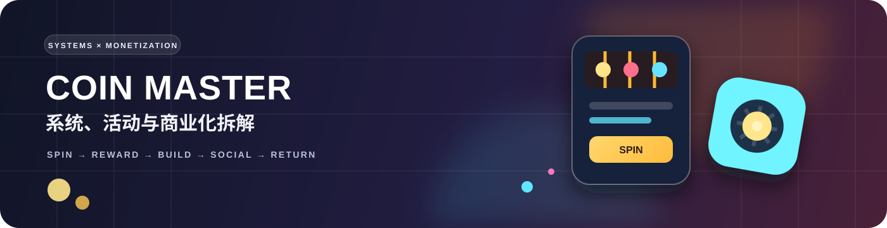

  

  <strong>随机性是入口，资源与目标管理才是长期留存的核心。</strong> 
  一份面向系统与商业化策划岗位的产品拆解案例

  
  
  

---

## 为什么拆 Coin Master

Coin Master 将老虎机的即时随机反馈、村庄建造的长期目标、玩家间的攻击与偷取，以及高密度限时活动组合成一个可持续运转的产品系统。

这份报告不只回答“它有哪些系统”，还会回答三个更适合展示系统与商业化能力的问题：

1. 这些系统如何共同驱动玩家的短、中、长期目标？
2. 商业化入口如何嵌入资源消耗与活动推进，而不是只依赖内容门槛？
3. 当产品进入成熟期、活动层级不断增加时，怎样降低玩家的目标冲突与决策疲劳？

## 核心结论

| 结论 | 我的判断 |
| :--- | :--- |
| **核心循环足够简单** | `Spin → 获得资源 → 建设 / 收集 → 解锁新目标 → 再 Spin` 无需复杂教学即可理解。 |
| **随机奖励承担注意力入口** | 老虎机提供高频刺激，攻击、偷取与护盾把单机式随机奖励转化为玩家关系。 |
| **长线目标依赖系统叠加** | 村庄、星级、卡牌、宠物、团队与限时活动分别承接不同周期的成长需求。 |
| **商业化依赖情境触发** | 资源耗尽、目标临近、活动将结束与竞争排名是主要付费情境。 |
| **成熟期的主要矛盾** | 不是玩家不懂核心循环，而是目标入口过多、计时压力叠加与活动同质化。 |

## 案例结构

| 章节 | 内容 |
| :--- | :--- |
| 01–03 | 研究边界、市场信号与玩家需求 |
| 04–07 | 核心循环、资源经济、社交关系与卡牌系统 |
| 08–10 | 活动体系、商业化机制与界面信息密度 |
| 11–12 | 产品诊断与原创 LiveOps 优化提案 |
| 13–14 | 指标体系、实验方案、风险与结论 |

## Deep Dives｜单活动深拆

| 活动 | 分析重点 | 报告 |
| :--- | :--- | :--- |
| **荒野大陆（Wildland Adventure）** | 地图推图、神庙探索、生命之树与限时竞赛如何组成长期活动；提出 Wildland Compass 优化方案。 | [阅读专题报告](./wildland-adventure-report.md) |

## 这份案例展示什么

- **系统拆解**：把看似分散的功能还原成资源、目标与反馈之间的关系。
- **商业化判断**：区分“用户需求”“付费触发”和“可能造成体验损耗的压力设计”。
- **方案能力**：提出一个可以定义规则、指标、实验和风险边界的系统方案。
- **研究纪律**：区分公开事实、个人观察与推断，不虚构内部数据。

---

  <a href="./report.md"><strong>开始阅读完整报告 →</strong></a>

  Research date: 2026-11 · Author: 代正伟

