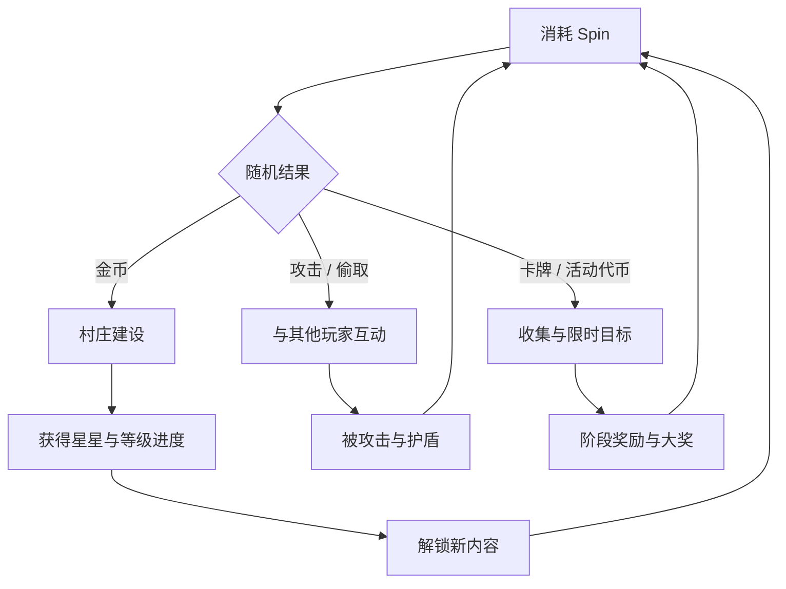
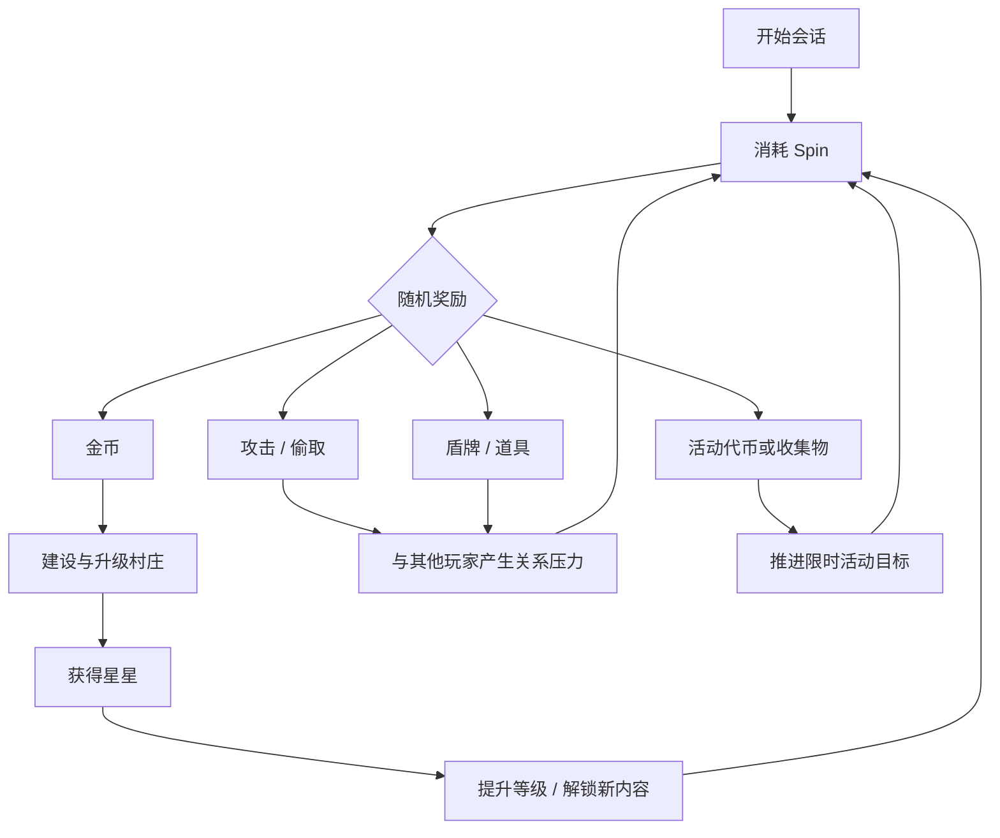
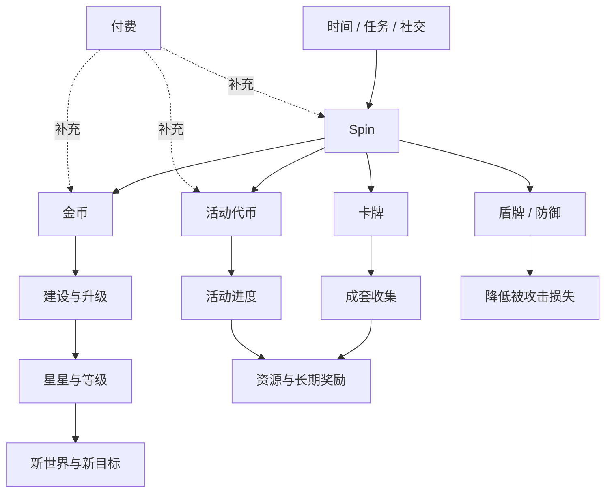
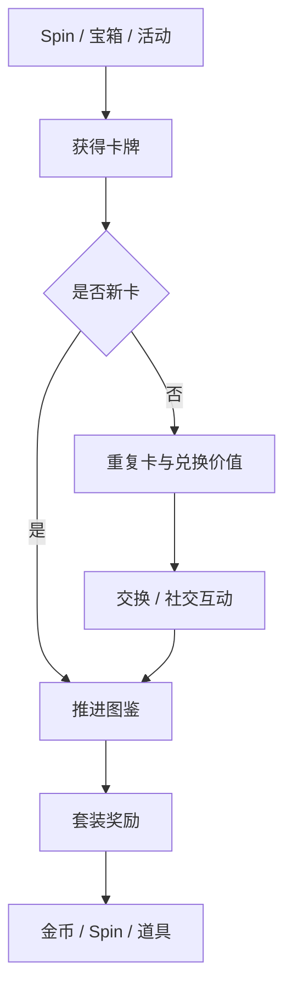
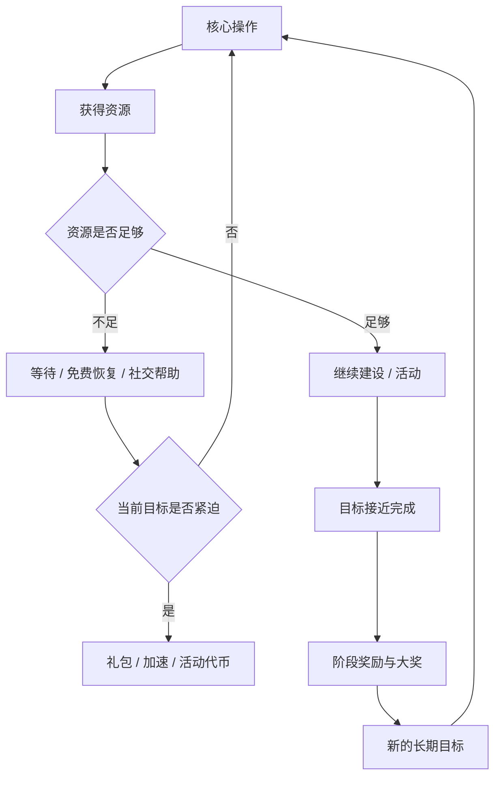
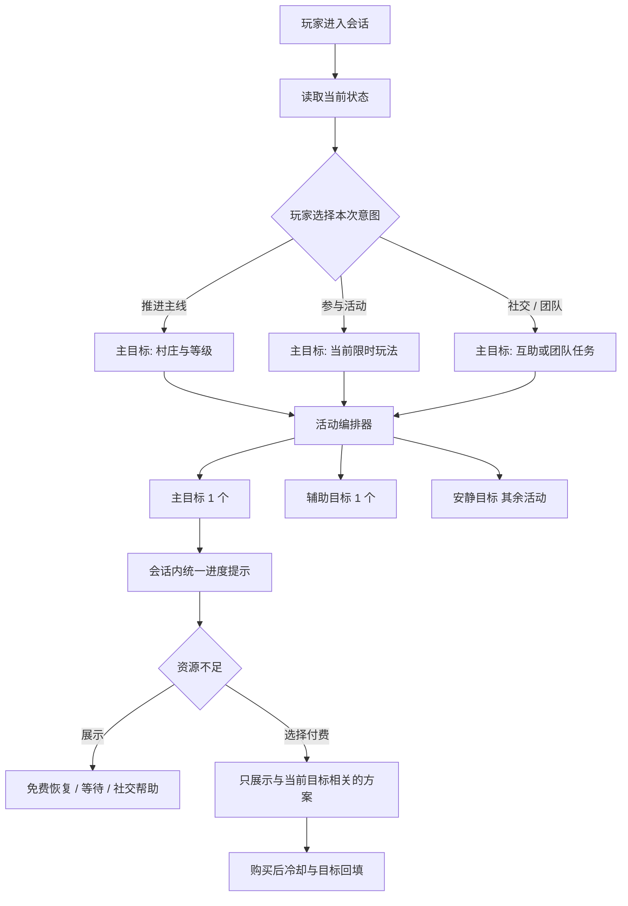

# Coin Master 产品拆解

## 系统、活动与商业化设计

> 研究对象：Moon Active《Coin Master》  
> 研究重点：核心循环、资源经济、社交关系、LiveOps、商业化与玩家体验  
> 研究日期：2026 年 11 月  
> 作者：代正伟

---

## 阅读说明

本文试图回答的不是“这款游戏有哪些功能”，而是：

1. Coin Master 如何把一个简单、随机的核心操作组织成长期可重复的游玩循环？
2. 各类系统如何分配资源、制造目标并互相导流？
3. 商业化入口如何嵌入玩家的即时需求与长期进度？
4. 当内容与活动数量持续增长时，系统应该如何避免目标和付费压力同时过载？

本文使用三类信息：

- **公开事实**：来自公开市场资料与产品页面；
- **体验观察**：来自 2025–2026 年的实际游玩与界面观察；
- **设计推断**：对设计意图、玩家心理和潜在影响的解释，不代表发行商内部设计目标。

---

## 01 执行摘要

Coin Master 的商业规模已由第三方长期跟踪。Sensor Tower 在 2024 年记录其累计玩家消费超过 60 亿美元；Mobilegamer.biz 的 2025 年年度盘点则显示，产品仍处于全球头部手游区间，但相较前一年出现回落。两组信息说明：它拥有成熟的规模基础，同时也会面对成熟产品如何持续更新的问题。[1][2]

这款产品的核心能力不是“老虎机”本身，而是把高波动随机奖励转译成连续的资源目标和关系压力：

由此可以拆出三个同时运转的循环：

- **即时循环**：Spin 产生奖励，先满足“再来一次”的即时反馈需求；
- **周期循环**：金币与建设推动等级和内容解锁，承接每日到每周的目标；
- **长线循环**：卡牌、宠物、团队和活动共同消耗资源、产生社交关系并延长生命周期。

商业化的核心逻辑也不是简单的内容付费墙，而是当玩家已经形成目标、接近奖励或处于竞争中时，提供加速资源。资源能否继续获得、目标是否足够清晰、下一次行动是否值得期待，共同决定付费入口是否自然。

本文最终提出 **LiveOps Conductor（活动编排器）**：不减少活动内容，而是根据玩家进入游戏时的意图，动态决定“主目标、辅助目标与安静目标”的展示权重，同时为付费入口增加透明度和冷却边界。它试图同时改善体验节奏与商业化效率，而不是单纯增加或压低活动数量。

---

## 02 研究边界与方法

### 2.1 研究边界

本文关注产品和系统层，不涉及以下内容：

- 未公开的收入拆分、用户画像和后台实验；
- 具体概率、后台配置、价格分层和活动奖励数值；
- 对 Moon Active 内部真实设计意图的断言；
- 将第三方收入估算当作公司审计财务数据。

市场表现只在“规模级信号”层面使用，不作为系统优劣的唯一证明。

### 2.2 研究方法

| 方法 | 执行方式 | 输出 |
| :--- | :--- | :--- |
| 体验记录 | 在不同账号阶段观察资源、功能入口和活动节奏 | 玩家可见的产品结构 |
| 系统映射 | 把资源流向、目标和解锁关系画成结构图 | 循环与依赖关系 |
| 竞品参照 | 对比同赛道的阶段、系统和商业逻辑 | 产品选择的相对差异 |
| 机制推演 | 从玩家决策点解释设计可能如何影响行为 | 待验证的设计假设 |
| 方案设计 | 针对一个明确问题提出规则、指标和实验 | 可讨论的优化提案 |

---

## 03 产品定位与市场信号

### 3.1 产品定位

Coin Master 可以概括为：

> 以随机奖励为即时入口、以村庄建设为长期载体、以玩家攻击与偷取为关系压力、以限时活动为运营节奏的休闲社交游戏。

其核心操作理解成本很低，但外围系统并不简单。游戏把多个目标层叠加在同一个主界面上：主玩法进度、资源储备、卡牌收集、团队关系、限时锦标赛和活动通行证都可能同时存在。

### 3.2 市场信号

Sensor Tower 的公开里程碑显示，Coin Master 的累计玩家消费在 2024 年已超过 60 亿美元。这能说明两点：

- 其核心循环具备长期变现与内容延展能力；
- 产品已经进入需要同时维护新用户、回流用户和长期用户的高复杂度阶段。

Mobilegamer.biz 对 2025 年移动游戏收入的盘点中，Coin Master 仍位列头部，但媒体转述的第三方估算显示其收入较 2024 年下降。这里更值得提出的问题是：

> 一个已经完成玩法验证的产品，如何避免在长期运营中把“内容更多”变成“目标更拥挤”？

收入变化可能来自买量成本、市场竞争、平台结构、区域收入、产品更新与统计口径等多种因素。不能据此单独归因于任何一项设计，但它提供了研究成熟期 LiveOps 复杂度的合理背景。

---

## 04 玩家需求与价值承诺

### 4.1 玩家的核心任务

从体验结构推断，产品主要满足以下需求：

| 需求 | 游戏中的表现 | 系统承接 |
| :--- | :--- | :--- |
| 低门槛刺激 | 一次点击即可制造随机结果 | Spin、倍率、特殊事件 |
| 可见成长 | 金币转化为村庄升级与等级变化 | 建设、星星、世界解锁 |
| 收集完成感 | 卡组、宠物、外观和活动奖励持续累积 | 宝箱、交换、活动 |
| 关系与竞争 | 攻击、偷取、护盾、团队排名 | 好友、团队、锦标赛 |
| 短期目标 | 倒计时、阶段奖励、排行榜 | 活动与通行证 |

### 4.2 不同玩家阶段的需求变化

- **新手阶段**：需要快速理解“Spin 能带来什么”和“下一步该做什么”；
- **中期阶段**：资源开始不足，建设周期变长，需要卡牌、宠物和活动提供新目标；
- **成熟阶段**：主线边际反馈下降，活动密度和社交关系承担更多在线理由；
- **回流阶段**：需要快速理解错过的内容，同时通过追赶奖励恢复目标感。

同一套活动系统在这些阶段的效率并不相同。新手最怕入口过多，成熟用户则可能最怕目标重复。这个差异是后文提出活动编排方案的基础。

---

## 05 核心循环拆解

### 5.1 基础循环

这个循环有三个值得注意的设计点。

### 5.2 随机结果同时服务多个系统

一次 Spin 的输出并不只属于主玩法：

- 金币服务于建设；
- 攻击与偷取服务于社交关系；
- 盾牌服务于风险管理；
- 卡牌、宠物食物或活动代币服务于长线系统；
- 部分结果会直接接入当前限时活动。

因此，“抽到东西”不仅是数值奖励，也会成为多个系统的共同输入。活动系统能够在不大改核心操作的前提下，高频复用同一次玩家行为。

### 5.3 损失与防御增加情绪波动

攻击和偷取把其他玩家引入原本高度自洽的单机式循环。玩家损失资源后可能：

- 立即修复或追回资源；
- 购买盾牌或资源；
- 通过反击重新获得控制感；
- 把关系压力转化为上线和参与活动的动力。

这是一种低强制性的社交压力设计。它有效，但需要严格控制频率、提示方式和损失上限，否则容易从“刺激”变成“被骚扰”。

### 5.4 建设承担节奏阀门

建设不是单纯把金币消耗掉，而是决定核心循环何时暂停、何时重新获得目标。资源需求会自然制造等待区间，而活动与礼包则可能在等待期间提供替代路径。

因此，评价建设设计不能只看“点击是否爽”，还要看：

- 玩家是否理解自己正在追求的下一项内容；
- 等待是否被转换成可选择的活动目标；
- 资源不足时是否总有免费恢复路径；
- 商业化入口是否准确承接了玩家已经表达出的需求。

---

## 06 资源经济

### 6.1 主要资源关系

### 6.2 资源层级

| 层级 | 资源 | 主要作用 | 设计价值 |
| :--- | :--- | :--- | :--- |
| 即时层 | Spin | 启动核心操作 | 可累积、可消耗、便于活动复用 |
| 通用层 | 金币 | 建设与升级 | 最直观的进度载体 |
| 防御层 | 盾牌 | 减少被攻击损失 | 把随机损失转化为可管理风险 |
| 收集层 | 卡牌、星星 | 成套目标与成长反馈 | 提供长线完成度和社交交换 |
| 活动层 | 活动代币、进度 | 限定时间内的额外目标 | 回收资源并调整短期节奏 |
| 成长层 | 宠物、等级、世界 | 长期能力与内容解锁 | 承接中期到长期留存 |

### 6.3 经济设计的强点

**第一，资源用途容易理解。**  
金币用于建设，Spin 用于启动核心玩法，卡牌用于收集，活动代币用于当期目标。玩家几乎不需要复杂解释就能知道资源“大概有什么用”。

**第二，同一次行为服务多个系统。**  
Spin 可以同时推进建设、卡牌、活动和团队任务，这让活动叠加具备天然的操作基础。

**第三，稀缺性与长期目标并存。**  
金币和 Spin 会周期性不足，但卡牌、村庄、宠物和等级又提供长期方向，玩家不会在资源不足时完全失去目标。

### 6.4 经济设计的风险

**风险一：目标竞争。**  
玩家一次 Spin 可推进多种活动，看起来效率很高，但当多个目标要求不同行为时，用户会难以判断“现在最值得做什么”。

**风险二：活动资源碎片化。**  
活动代币、进度票、特殊卡牌等临时资源不断增加时，主界面信息和库存认知成本会上升。

**风险三：等待与付费边界模糊。**  
如果资源不足后的第一步总是付费提示，而不是明确的免费恢复路径，玩家会感觉自己被持续推向购买。

---

## 07 社交系统

### 7.1 三种关系

Coin Master 的社交系统可拆成：

1. **资源型关系**：好友互赠、卡牌交换、团队互助；
2. **竞争型关系**：攻击、偷取、排行榜与锦标赛；
3. **归属型关系**：团队、共同目标、长期成员身份。

三种关系承担的心理功能不同：

| 关系 | 玩家收益 | 商业价值 | 风险 |
| :--- | :--- | :--- | :--- |
| 资源型 | 降低收集门槛 | 提升活跃、回流与参与 | 变成机械互赠 |
| 竞争型 | 刺激、反击、排名 | 推动 Spin、活动与加速消费 | 被攻击挫败、社交压力 |
| 归属型 | 团队身份与共同目标 | 延长生命周期、提高换游成本 | 活跃成员负担过重 |

### 7.2 社交压力如何嵌入核心循环

社交不是与主玩法分离的“聊天室”，而是核心循环的一部分。玩家被攻击、被偷取或看到好友在活动中领先时，会产生一个自然的问题：

> 我要不要现在上线、组织反击、保护资源或追赶排名？

这种设计提高了事件触发频率，但也意味着游戏需要主动管理负面情绪。尤其是对低资源、低活跃或刚回流的玩家，过度攻击会造成明显的挫败感。

### 7.3 改进入口

相比继续增加攻击强度，更值得验证的是：

- 为低活跃玩家提供更多“恢复与保护”型社交；
- 让团队任务区分活跃贡献者和轻度参与者；
- 让攻击与被攻击的提示具备可控频率；
- 在竞争之外增加“共同建造”“共同解锁”的目标。

---

## 08 卡牌与收藏系统

### 8.1 为什么卡牌适合这类产品

卡牌收集解决了三个关键问题：

- 把随机奖励转化为可展示的长期成果；
- 为好友、团队与活动提供轻量互动载体；
- 让不同活动都能通过卡包、交换或收集进度连接到同一长期系统。

从结构上看，卡牌不是一次性的奖励，而是一套“收藏进度 + 社交交换 + 套装完成”的目标网络。

### 8.2 收集系统的反馈层级

### 8.3 商业与体验平衡

卡牌收集天然适合长线付费，但也会产生两个风险：

- 缺少最后一张卡时的挫败感过强；
- 如果交换、赠送和活动掉落不能形成稳定补充，用户会把卡组完成理解为纯付费目标。

更好的做法不是简单提高掉落，而是给玩家更多可控路径：交换、团队帮助、保底目标、活动定向补充，以及清晰可见的下一步来源。

---

## 09 活动与 LiveOps

### 9.1 活动分类

体验中可以观察到多种活动结构：

| 活动类型 | 主要目标 | 与主循环的关系 |
| :--- | :--- | :--- |
| 每日任务 | 建立登录与操作习惯 | 重复基础行为，发放稳定资源 |
| 锦标赛 | 短时冲分与排名竞争 | 把 Spin 结果转化为活动积分 |
| 消耗任务 | 回收 Spin 与资源 | 在目标压力下形成补充需求 |
| 棋盘 / 走格玩法 | 增加主线外进度 | 活动代币与关键格子制造阶段性冲刺 |
| 通行证 | 绑定日常与周常活跃 | 用免费与付费双轨承载长周期奖励 |
| 指定结果收集 | 提高 Spin 频率 | 强化单次操作的额外价值 |
| 限时增益 | 调节资源获取效率 | 与锦标赛等活动叠加使用 |

### 9.2 活动系统的真正作用

限时活动并非只是“加一个玩法”，它还承担以下功能：

- **补充主线目标**：在建设等待或资源不足时提供下一步行动；
- **复用主操作**：不要求玩家学习新核心玩法，也能产生新目标；
- **调节资源消耗**：通过任务设计回收积压资源；
- **制造运营峰值**：用倒计时、排行榜和大奖推动集中活跃；
- **承接商业化**：将资源缺口与活动进度连接。

### 9.3 叠加的双刃剑

一个玩家可能同时在推进：

- 主线村庄；
- 卡牌收集；
- 日常任务；
- 24 小时锦标赛；
- 长周期通行证；
- 当前限时小玩法；
- 团队共同目标。

这种叠加能提高单次 Spin 的价值，也会显著提高认知负担。玩家不是缺少事情做，而是需要判断“我现在到底在做什么”。

---

## 10 商业化拆解

### 10.1 商业化不是单一商店

Coin Master 的商业化更像一条围绕玩家状态展开的决策链：

### 10.2 典型付费情境

| 情境 | 玩家当下想完成什么 | 商业化切入点 |
| :--- | :--- | :--- |
| 资源耗尽 | 再 Spin、继续建设 | Spin / 金币补充、限时礼包 |
| 目标临近 | 完成阶段奖励或大奖 | 活动代币、进度加速 |
| 排名竞争 | 保持或追赶锦标赛位置 | 高倍率资源、代币包 |
| 收集卡组 | 补齐稀有卡或最后一张 | 卡包、活动资源、交换支持 |
| 团队压力 | 为团队贡献或避免拖累 | 资源包、团队活动加成 |
| 时间限制 | 在活动结束前完成目标 | 限时折扣、立即解锁 |

### 10.3 商业化设计的有效点

**情境相关性高。**  
玩家先产生明确需求，再看到解决该需求的商品，购买理由容易理解。

**目标梯度清晰。**  
阶段奖励和大奖让玩家看见“还差多少”，缩短了从愿望到行动的心理距离。

**付费不阻断主内容。**  
主体玩法、卡牌和村庄仍然能通过免费路径推进，商业化更多承担加速与追赶。

### 10.4 需要警惕的部分

- 奖励刚刚出现时立刻弹出付费，容易把正反馈变成推销；
- 多层进度条和大奖预览可能夸大当前可达性；
- 限时、排名和团队责任叠加时，用户可能产生被迫感；
- 如果频繁用“差一点”制造购买冲动，长期会损伤信任。

系统与商业化策划不应只看短期转化，也需要把退出率、负面反馈、退款与后续复购纳入设计边界。

---

## 11 界面与信息架构

### 11.1 首屏的职责

Coin Master 的主界面并不是一个纯功能页面，而是活动总览、资源状态、核心操作和商业化入口的组合界面。

一个成熟账号的首屏可能同时出现：

- 金币、Spin、盾牌；
- 村庄建设进度；
- 卡牌与收集目标；
- 多个活动入口；
- 限时倒计时；
- 阶段奖励进度；
- 玩家头像和社交信息。

### 11.2 高信息密度的收益

- 玩家随时知道存在更多目标；
- 活动可以低成本获得入口曝光；
- 不同付费动机可以在同一界面被触发；
- 长期用户能够快速找到养成与社交模块。

### 11.3 高信息密度的代价

- 新用户难以判断优先事项；
- 回流用户需要重新理解错过内容；
- 多个倒计时共同制造紧迫感；
- 限时图标与进度条可能遮挡主操作的情绪焦点；
- 对轻度和低付费用户可以形成“永远做不完”的压力。

界面不是单纯的美术问题，而是目标优先级问题。真正需要设计的不是“还能放多少活动”，而是“当前会话最应该突出什么”。

---

## 12 产品诊断

### 12.1 优势

1. **核心循环极短**：一次 Spin 即可完成操作，几乎没有学习门槛。
2. **奖励复用率高**：一次操作同时服务多个系统，活动开发能够复用主玩法。
3. **长期目标分层完整**：建设、卡牌、宠物、团队和活动覆盖不同周期。
4. **社交关系深入核心**：攻击、偷取、互助与竞争都不是外围装饰。
5. **商业化情境明确**：资源、目标、倒计时和排名为付费提供了具体场景。

### 12.2 核心矛盾

产品成熟期的关键矛盾可以归纳为：

> **目标数量增长快于玩家注意力和资源恢复速度。**

表现可能是：

- 一次会话需要处理多个互相竞争的任务；
- 活动结束时间密集，造成短期过度活跃；
- 玩家为了不浪费资源而机械完成低价值任务；
- 资源不足时，付费提示先于清晰的免费选择出现；
- 新玩法和旧活动同时保留，但缺少统一优先级。

### 12.3 设计假设

以下结论需要通过真实数据和实验验证：

- 轻度用户的主要流失点可能是目标冲突，而不是玩法难度；
- 中高活跃用户更容易被多个限时活动同时牵引；
- 清晰目标组合可能提高阶段完成率，但会降低单用户的活动曝光次数；
- 延迟付费提示、先提供免费恢复路径，可能降低短期转化，但改善后续复购与口碑。

---

## 13 原创提案：LiveOps Conductor

### 13.1 设计目标

**在不减少活动供给的前提下，降低玩家在单次会话中的目标冲突，让玩家更容易理解“我现在最值得做什么”，并让商业化只承接已经出现的明确需求。**

目标不是让游戏不再商业化，而是让商业化与清晰的玩家意图对齐。

### 13.2 设计原则

1. 玩家拥有目标选择权；
2. 同一时间只突出一个主压力目标；
3. 每次资源不足都优先展示免费或等待路径；
4. 付费入口说明解决什么问题，不使用虚构倒计时；
5. 付费后设置冷静窗口，避免连续推销。

### 13.3 系统结构

### 13.4 核心规则

#### 规则一：意图选择

进入游戏时为玩家提供三种轻量入口：

- **推进主线**：优先显示村庄、等级与建设资源；
- **参与活动**：优先显示当前活动的主目标与结束时间；
- **帮助团队**：优先显示可互助、可贡献的社交目标。

选择不是强制模式，也不会关闭其他系统，只影响当前会话的信息排序。

#### 规则二：主、辅、安静三层目标

- 主目标：最多一个，占用最强视觉和提醒资源；
- 辅助目标：最多一个，提供次要动机；
- 安静目标：继续存在，但降低动效、红点和弹窗频率。

这样既保留活动供给，又避免全部活动争抢同一条注意力通道。

#### 规则三：压力错峰

对活动结束时间进行组合约束：

- 避免多个高压力活动在同一短时间窗口同时结束；
- 高压力活动与长周期收集/养成活动错位；
- 玩家错过一个非主目标时，提供明确但不夸大的补偿说明。

#### 规则四：可解释的付费转换

资源不足时依次提供：

1. 免费恢复方式；
2. 等待或次日重试；
3. 社交帮助；
4. 与当前目标直接相关的付费选项。

付费选项必须说明：

- 获得什么；
- 可以推进到哪一步；
- 是否有时限；
- 是否存在免费替代路径。

#### 规则五：购买后冷却

完成购买后，目标回填到下一阶段，并设置一段不触发同类付费弹窗的保护窗口。这样可以减少“购买后立刻再次被索要”的负面体验。

### 13.5 玩家分层

| 玩家类型 | 识别信号示例 | 目标编排倾向 |
| :--- | :--- | :--- |
| 推进型 | 集中建设、快速消耗金币 | 主推村庄与等级目标 |
| 活动型 | 高频参与限时玩法 | 主推当前活动与阶段奖励 |
| 收集型 | 连续获取卡牌、关注套装 | 主推卡包、交换与收集目标 |
| 社交型 | 经常互助、参与团队活动 | 主推团队贡献与合作目标 |
| 轻量型 | 会话短、操作少 | 减少同时出现的压力目标 |

这些信号只用于排序，不应演变为对高意向用户的过度推销。

### 13.6 示例会话

玩家选择“推进主线”：

1. 首页突出村庄下一项建设与所需资源；
2. 当前最能提供金币的活动被标为辅助目标；
3. 其他活动保留入口，但不再同时弹出提示；
4. 金币不足时，先显示等待、好友帮助或可参与的免费目标；
5. 玩家主动查看加速方案后，再出现与金币相关的付费选项；
6. 完成升级后，界面回到新的主线目标，而不是立即弹出下一组礼包。

---

## 14 指标与实验方案

### 14.1 指标体系

| 层级 | 指标 | 目的 |
| :--- | :--- | :--- |
| 体验 | 会话内主目标完成率 | 玩家是否能理解并达成目标 |
| 体验 | 活动退出率 / 放弃弹窗率 | 是否出现目标疲劳 |
| 留存 | D1、D7、D30 | 中期留存是否改善 |
| 活跃 | 日会话数、有效游玩时长 | 区分自然活跃与被迫延长 |
| 社交 | 互助率、团队任务参与率 | 社交循环是否更健康 |
| 商业 | 礼包点击率、转化率、ARPPU | 商业化是否稳定 |
| 商业 | 7 日复购率、退款率 | 是否存在短期透支 |
| 口碑 | 负面评价、客服投诉、压力反馈 | 是否产生体验反噬 |

### 14.2 实验设计

建议先在一个玩家分层上做 A/B 测试：

- **对照组**：现有活动展示与商业化触发；
- **实验组 A**：启用主 / 辅 / 安静三层目标；
- **实验组 B**：在 A 的基础上增加“免费恢复优先”的付费入口顺序；
- **实验组 C**：再增加购买后冷静窗口。

### 14.3 成功标准

至少同时满足：

- 主目标完成率提升；
- D7 留存不下降；
- 活动退出与误触率下降；
- 付费转化不显著下降，或下降幅度小于体验指标改善；
- 复购率、退款与负面反馈不恶化。

单一的收入提升不能证明方案成功。若收入和短期转化上升，但满意度、复购和留存下降，应视为高风险结果。

---

## 15 实施路径与风险

### 15.1 分阶段落地

| 阶段 | 目标 | 交付 |
| :--- | :--- | :--- |
| 1. 数据梳理 | 找出活动叠加、资源不足和付费弹窗的高峰 | 行为漏斗与压力时段图 |
| 2. 原型验证 | 验证玩家能否理解目标优先级 | 可点击原型、访谈 |
| 3. 小流量实验 | 验证留存、任务完成和商业化影响 | A/B 测试 |
| 4. 扩量迭代 | 调整目标权重、活动错峰与冷却规则 | 版本配置与监控面板 |

### 15.2 主要风险

**收入短期下降。**  
减少重复曝光可能降低短期商品点击，需要用复购、留存和长期价值评估。

**活动曝光减少。**  
安静目标可能降低活动参与率，因此需要验证主目标完成后的目标回填是否顺畅。

**个性化偏差。**  
根据行为分配目标可能导致某些玩家看到更少内容，需要设置最低内容覆盖与公平性监控。

**算法不透明。**  
如果玩家不理解为何看到某个目标或商品，应提供清晰说明和可控选项。

### 15.3 伦理边界

该系统不采用以下方式：

- 伪造倒计时或虚假稀缺；
- 用隐藏概率制造不可解释的损失；
- 针对情绪脆弱或冲动消费玩家增加压力；
- 让玩家无法判断购买和免费路径的实际差异。

---

## 16 结论

Coin Master 的设计价值，不在于把老虎机、建造、卡牌和社交简单堆在一起，而在于让它们共享同一次操作、同一套资源和同一个长期目标。

它最强的地方，是极低理解成本和高密度目标之间的平衡；它最大的长期风险，也是目标密度继续增长后，玩家不知道该把注意力放在哪里。

因此，面向成熟阶段的优化重点不一定是继续增加玩法，而是建立一套管理注意力的系统。LiveOps Conductor 将活动、资源和商业化从“同时争抢玩家”转为“根据当前意图按优先级编排”，其核心是：

> 先让玩家知道自己为什么回来，再决定系统应该展示什么、何时提供帮助，以及何时适合提出付费选择。

---

## 附录：公开资料

1. Sensor Tower, *Coin Master surpasses $6 billion in revenue*  
   <https://sensortower.com/blog/coin-master-reaches-6-billion-revenue>

2. Mobilegamer.biz, *2025’s top grossing mobile games*  
   <https://mobilegamer.biz/the-top-grossing-mobile-games-of-2025/>

3. Coin Master 官方产品页  
   <https://www.coinmastergame.com/>

> 注：市场收入属于第三方估算，可能因统计时间、平台、地区及“流水 / 净收入”等口径不同而变化。本文只将其作为规模与趋势参考。

---

## 作者说明

这是一份公开的产品分析练习，与 Moon Active 无隶属关系。报告刻意省略后台数据、具体概率、活动配置与实现细节，并把未经数据验证的解释明确标注为设计推断。
