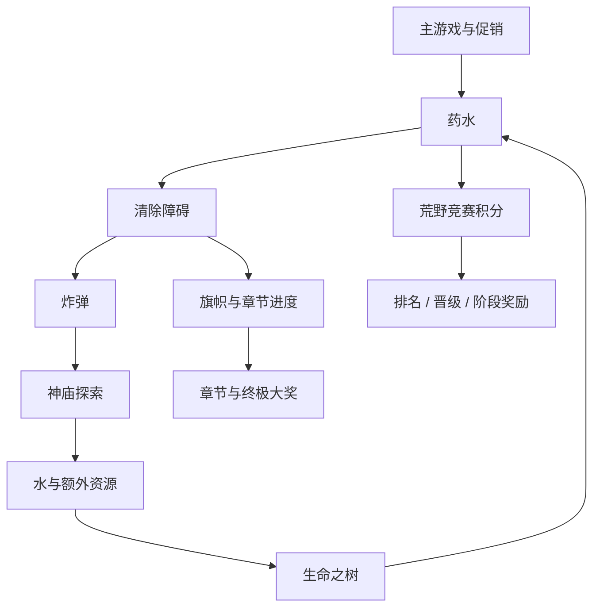
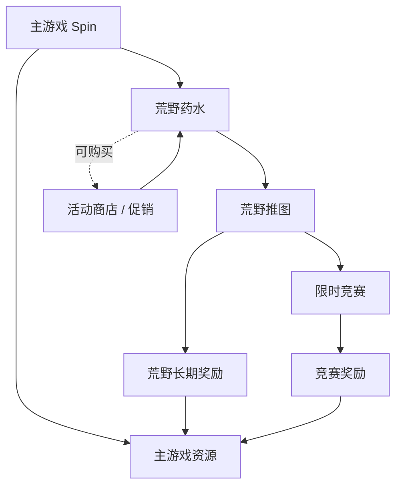
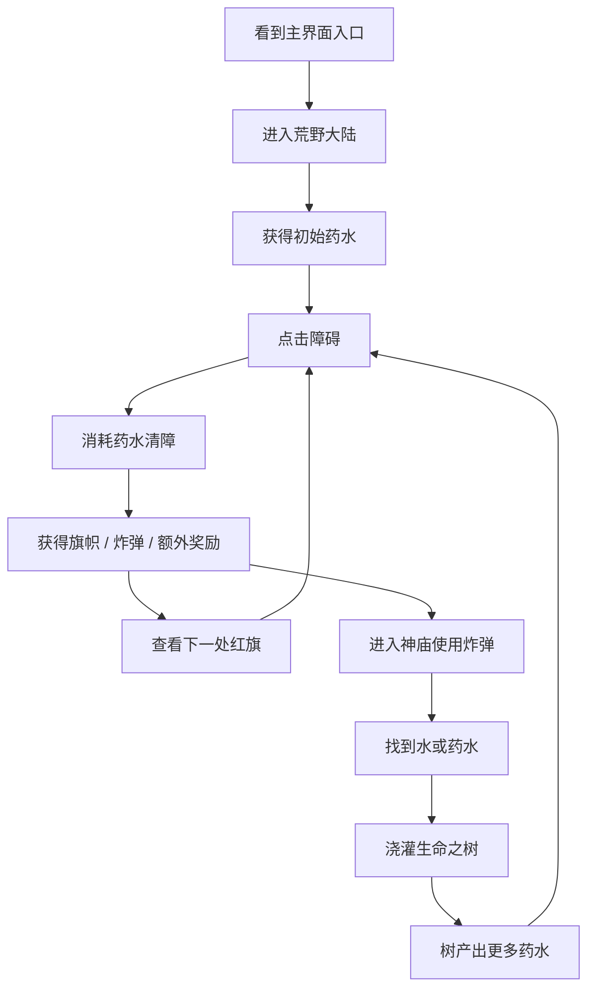
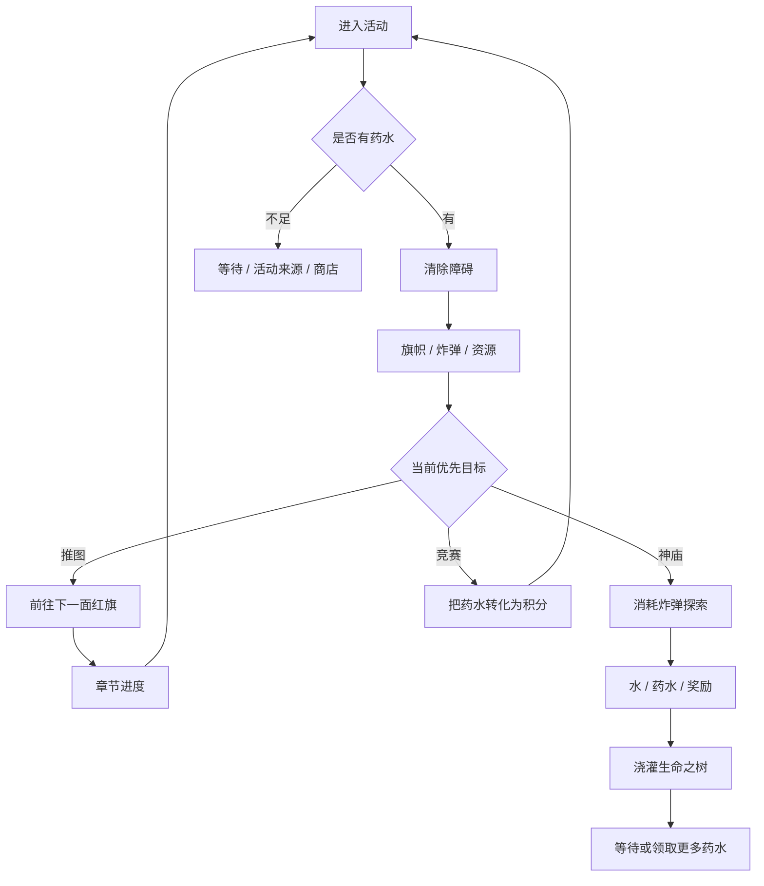
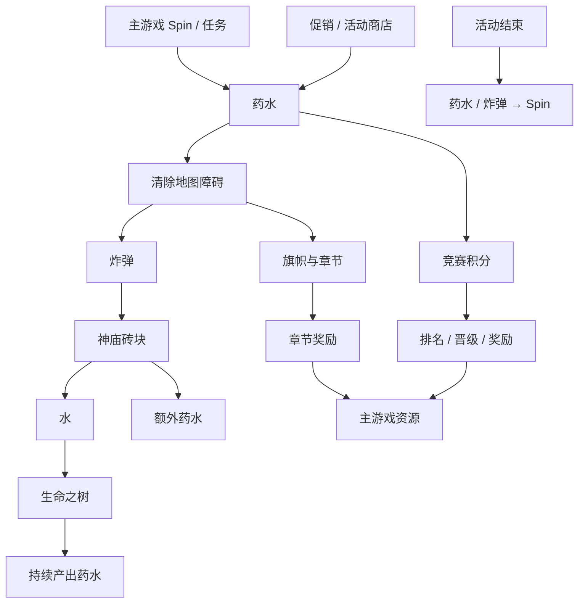
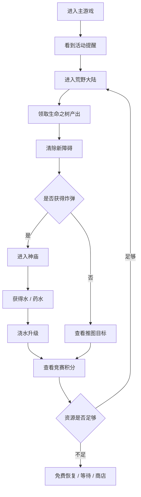
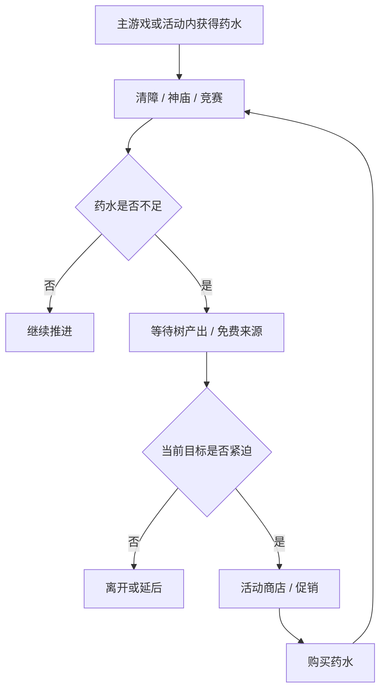
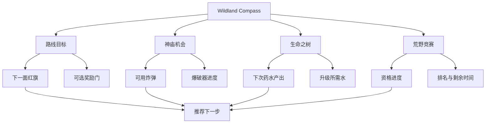

  

  <strong>一个常驻玩法，如何同时服务推图、留存、竞争与商业化。</strong> 
  Coin Master · Wildland Adventure 活动专题拆解

> 研究对象：Coin Master 的 Wildland Adventure  
> 中文名称说明：官方繁体中文帮助中心称“荒野历险”，本文沿用你常用的“荒野大陆”称呼。  
> 研究日期：2026 年 11 月

---

## 01 一页结论

荒野大陆不是普通的一次性限时活动，而是一个与主游戏并行的长线进度容器。它以药水作为行动资源，串联起四条互相咬合的循环：

1. **地图推图**：消耗药水清除障碍，收集旗帜推进章节；
2. **神庙探索**：用障碍中获得的炸弹开启砖块，寻找水、药水或特殊奖励；
3. **生命之树**：用找到的水浇灌树，树持续产出更多药水；
4. **限时竞赛**：收集药水转化为竞赛积分，形成排名、晋级、退级与阶段奖励。

其设计优势在于，同一份核心资源被四种不同时间尺度反复利用：

但这套结构也制造了明显的理解成本：玩家需要同时理解药水、炸弹、水、旗帜、树等级、竞赛积分与检查点。一个内容充足的常驻活动，可能因为资源转换链不直观而无法被玩家充分体验。

本文的核心判断是：

> 荒野大陆的真正问题不是“玩法不够多”，而是如何让玩家在多条嵌套循环中始终知道下一步最值得做什么。

因此，本文最后提出 **Wildland Compass（荒野导航）**：把推图、神庙、生命之树与竞赛统一到一条可解释的行动建议中，并为竞赛资格、资源转换和活动末期的清理提供明确反馈。

---

## 02 调研边界

### 2.1 已确认事实

本文涉及的玩法结构以 Coin Master 官方网站帮助中心公开说明为主：

- 点击主界面活动徽章进入荒野大陆；
- 使用药水清除阻挡道路的物体；
- 清除障碍可发现炸弹；
- 在荒野神庙使用炸弹炸开砖块，寻找水、药水或其他奖励；
- 水罐用于浇灌生命之树，树会随时间产出药水；
- 清除障碍获得旗帜，旗帜填满阶段进度后可进入下一阶段；
- 完成章节后获得阶段奖励与终极大奖；
- 荒野竞赛使用药水收集产生的积分排名；
- 竞赛要求玩家完成当前进度条的全部积分才具备奖励资格；
- 未达到积分可能回退一个关卡，但不会低于检查点；
- 活动结束时未使用的药水和炸弹会转换为 Spin；
- 地图支持指南针、阻挡箭头、地图缩放和传送等导航辅助；
- 特殊大门提供额外奖励，但可以跳过大门继续主线章节。

### 2.2 本文不采用的信息

- 不猜测后台概率、具体掉落权重和活动配置；
- 不把活动商店价格当作官方定价；
- 不推断 Moon Active 的内部设计目标；
- 不披露任何现任职场的内部资料；
- 不把未公开数值写成事实。

---

## 03 它在 Coin Master 中的位置

### 3.1 不是“多加一个活动”，而是第二条成长线

主线村庄提供的是“建造与等级”的长期目标；卡牌提供的是“收集与套装”的长期目标；荒野大陆则提供一条以**探索地图**为表现的新进度线。

它借用了主游戏最成熟的资源入口：活动药水可以通过游戏、促销和活动内产出获得。这样，玩家不需要学习新的基础操作，荒野大陆也能持续获得活跃用户。

### 3.2 对主循环的价值

| 作用 | 对玩家的价值 | 对产品的价值 |
| :--- | :--- | :--- |
| 稀释单一老虎机疲劳 | 提供新的行动目标 | 复用主游戏的活跃与付费用户 |
| 补充长期进度 | 地图、章节、树等级与竞赛 | 延长目标消耗周期 |
| 复用资源循环 | 药水与 Spin 可互相转化 | 连接活动与主商业化 |
| 增加回流触点 | 树产出、阶段奖励与竞赛 | 提升登录和回归动机 |

### 3.3 与主游戏的关系

这张图说明了荒野大陆的定位：

- 它需要主游戏提供流量与资源；
- 它反过来为主游戏提供额外奖励和新目标；
- 限时竞赛则把常驻系统重新包装成短期运营活动；
- 活动商店和促销在药水不足时形成商业化承接。

---

## 04 玩家旅程

### 4.1 首次进入

首次体验的关键不是学会按按钮，而是理解“药水不是只用来清路”：

- 药水是推图燃料；
- 炸弹是第二层探索燃料；
- 水是生产链燃料；
- 药水又同时是竞赛积分来源。

如果一个玩家只把药水理解为“清路道具”，就会错过树、神庙和竞赛之间的联动；如果只把它理解为“竞赛积分”，又可能为了抢排名忽略长期推图。

### 4.2 分阶段玩家目标

| 玩家阶段 | 主要关注 | 系统应回答的问题 |
| :--- | :--- | :--- |
| 新进入 | 怎样前进、奖励在哪里 | 下一步点哪里？ |
| 初次推图 | 旗帜、章节和特殊大门 | 推图与支线应该怎么选？ |
| 形成日常习惯 | 生命之树和药水产出 | 何时回来、如何提高产出？ |
| 参与竞赛 | 积分、排名和资格 | 我离奖励还差多少？ |
| 成熟期 | 终极大奖、地图完成与效率 | 长期投入是否值得？ |

---

## 05 核心循环

### 5.1 单次会话循环

这比“一次点击获得奖励”的主循环更接近一个**资源路由器**：玩家每次消费药水，都要选择它流向推图、神庙、树还是竞赛。

### 5.2 三层时间结构

| 循环层 | 主要行为 | 反馈周期 | 长期作用 |
| :--- | :--- | :--- | :--- |
| 会话层 | 清障、找炸弹、浇树 | 秒到分钟 | 提供即时操作反馈 |
| 日循环 | 树产出、阶段奖励、资源积累 | 小时到天 | 建立回来看看的习惯 |
| 赛季层 | 地图章节、竞赛晋级、大奖 | 天到周 | 承载长线竞争与追求 |

这是本案最值得学习的地方：常驻活动并不依靠单一倒计时，而是把不同时间尺度叠成一个多层目标系统。

---

## 06 子系统一：地图推图

### 6.1 核心规则

玩家通过药水清除障碍并收集旗帜，旗帜填满阶段进度后进入下一阶段。地图上不仅有主线道路，还可能出现通往额外奖励的特殊大门。

### 6.2 设计价值

**第一，地图让进度可视化。**

玩家不仅知道“还差多少资源”，还能看到自己在地图上的位置、下一面红旗以及前方仍未开启的区域。

**第二，支线提供主动选择。**

特殊大门不是继续主线的前提，但能提供额外奖励。这让玩家在“直冲下一章”与“绕路获取额外收益”之间作出选择。

**第三，导航辅助降低地图复杂度。**

红旗作为指南针、阻挡障碍显示箭头、地图可缩放与双击传送，都是在解决同一问题：地图越大，越不能让探索欲变成迷路。

### 6.3 仍需验证的体验风险

- 新玩家是否理解特殊大门是可选支线；
- 地图放大、缩放和传送是否会被高频使用；
- 当路径目标与竞赛目标冲突时，玩家是否知道优先做什么；
- 章节长度与药水需求是否形成合理节奏，而不是单纯把内容做长。

---

## 07 子系统二：神庙与炸弹

### 7.1 第二层随机奖励

神庙是荒野大陆中的嵌套随机玩法：

1. 清障获得炸弹；
2. 消耗炸弹敲开砖块；
3. 结果可能为空，也可能是水、药水或额外奖励；
4. 每次使用炸弹还会积累爆破器进度；
5. 进度满后可获得一次清理多个砖块的强化道具；
6. 活动结束时未使用炸弹转化为 Spin。

### 7.2 业务作用

这个子系统让清障行为产生了“第二次期待”：

- 清障本身提供旗帜与推图进度；
- 清障掉落的炸弹带来额外随机奖励；
- 随机奖励中的水又回到生命之树生产链；
- 炸弹余量最终转回主游戏资源。

它相当于在主活动内部增加了一条短局随机反馈，同时避免了单独为神庙重新设计一套入口和资源。

### 7.3 主要风险

**风险一：奖励链不透明。**  
如果玩家不清楚炸弹怎么来、水的用途是什么、爆破器进度何时触发，神庙会被理解为一个“点着玩”的随机按钮。

**风险二：空结果削弱期待。**  
随机探索本身可以制造刺激，但当玩家缺少清晰的保底感或阶段推进感时，空砖块容易变成挫败。

**风险三：资源回流影响主经济。**  
活动末期炸弹与药水转换成 Spin，虽然能减少清零损失，但也会改变主游戏 Spin 的供给预期。需要监控活动结束前后的资源峰值与付费转化。

---

## 08 子系统三：生命之树

### 8.1 设计机制

生命之树是荒野大陆的“时间资源生产器”：

- 推图过程中收集种子；
- 在神庙中获取水；
- 用水提升生命之树等级；
- 树会随时间产出药水；
- 树等级提高后，单次可获得的药水量会增加；
- 玩家可查看下一次升级能带来的药水收益。

### 8.2 它解决了什么问题

主游戏的资源恢复依赖 Spin 和时间。荒野大陆若完全依赖外部药水，会让活动成为主玩法附属；生命之树则让活动拥有自己的“回流机制”：

- 玩家暂时没有药水时，仍有可回来领取的产出；
- 水滴让神庙探索与长期成长相连；
- 树等级让“现在浇灌”具有未来收益，而不只是一次性清空资源。

### 8.3 可能的体验问题

- 树产出是否足够可见，决定玩家能否形成回来领取的习惯；
- 如果升级收益难以比较，玩家会缺少继续浇水的目标；
- 等待生产与限时竞赛可能形成节奏冲突：短期竞赛要求持续消费，长期树系统鼓励保留与积累；
- 如果树产出的药水会成为竞赛积分，树就同时服务留存和竞争，设计权重需要谨慎。

---

## 09 资源经济

### 9.1 资源流图

### 9.2 经济系统的三个强点

1. **资源有多个出口，但没有脱离主游戏。**  
   药水推动活动进度，活动奖励又回补 Spin、宝石等主资源。

2. **短期消耗与长期生产并存。**  
   清障需要即时消耗药水，生命之树又提供随时间增长的产出，平衡了“一次性刷完”和“每天回来”。

3. **随机奖励被嵌入确定性进度。**  
   神庙探索包含随机性，但推图旗帜、树等级与爆破器进度仍提供确定的方向。

### 9.3 核心风险

- 转换节点过多，新人难以算清资源价值；
- 活动资源与主游戏 Spin 的双向转换，可能影响主循环的稀缺感；
- 多条资源线同时存在，容易让玩家在“应该推图、探神庙、浇树还是冲竞赛”之间反复犹豫；
- 末端转换可以降低损失，也可能导致玩家把活动理解为“囤资源等结算”。

---

## 10 子系统四：荒野竞赛

### 10.1 竞赛结构

荒野竞赛是叠加在常驻地图上的限时竞争层：

- 进入竞赛页面可查看分数、进度与排名；
- 每获得一瓶药水，会转化为竞赛积分；
- 计时结束前完成进度要求，并进入前三名，可获得特别奖励；
- 完成本轮进度条的积分才具备领奖资格；
- 未达到积分可能回退一个关卡，但不会低于检查点；
- 完成最终关卡还有独立终极大奖。

### 10.2 常驻活动为什么还要竞赛

如果荒野大陆只有地图与树，它会是一条偏慢的长线养成线。限时竞赛提供三个额外作用：

- 将长期资源消费重新集中在短周期；
- 给药水收集增加排名与晋升动机；
- 用固定时间窗恢复运营节奏。

这也意味着荒野大陆不是一个单一活动，而是：

> **常驻结构 + 周期性竞争层 + 内嵌随机层 + 时间生产层。**

### 10.3 竞赛设计的潜在问题

**资格门槛与排名奖励叠加。**  
玩家不仅要竞争排名，还要先完成进度要求。对于进度较慢的玩家，可能同时承受“拿不到前三”和“未达到领奖线”的双重挫败。

**退级与检查点。**  
检查点保护了长期投入，但也意味着玩家需要理解自己的当前位置、晋级条件和降级风险。

**消费压力叠加。**  
竞赛要求持续获取药水时，活动商店会从“可选加速”变成“维持目标感的路径”。需要特别关注资源不足时的付费弹窗顺序。

---

## 11 会话结构与节奏

### 11.1 一次典型会话

### 11.2 节奏判断

这个结构很可能在不同玩家身上形成三种体验：

- **推进型**：主要清障、开章节和拿终极大奖；
- **收集型**：更关注树产出、神庙随机奖励和资源转换；
- **竞争型**：按竞赛倒计时分配药水，冲排名与晋级。

问题在于，这三类目标共享同一份药水。系统必须在界面上明确标出当前最重要的目标，否则玩家很容易因为“做什么都像是在错过另一件事”而降低体验。

---

## 12 商业化设计

### 12.1 已知入口

官方帮助说明，除游戏与生命之树产出外，玩家也可以通过活动内的促销入口获得药水。由此可以确认，药水是活动内的关键可售资源。

### 12.2 商业化链路

### 12.3 付费动机

| 情境 | 玩家目标 | 商业化承接 |
| :--- | :--- | :--- |
| 清障差少量药水 | 到达下一面红旗 | 药水补充 |
| 神庙差一次探索 | 获得水或阶段奖励 | 炸弹 / 药水组合 |
| 树差一次升级 | 提升未来产出 | 水或活动资源 |
| 竞赛接近资格线 | 保住领奖资格 | 药水加速 |
| 竞赛接近前三 | 保持排名 | 限时资源包 |
| 活动即将结束 | 用掉剩余资源 | 末段消耗与兑换提示 |

### 12.4 商业化质量判断

**优点：付费与玩法目标强相关。**  
玩家缺少的不是抽象货币，而是能直接完成当前地图或竞赛目标的药水。

**风险：目标叠加放大购买压力。**  
推图、神庙、树和竞赛同时存在时，药水不足可能触发四种不同的损失感。商业化系统必须避免把所有损失感集中成连续弹窗。

**建议：先解释可免费获得多少，再展示购买选项。**  
例如在“还差 3 瓶药水”时，先告诉玩家树什么时候产出、还有哪些免费来源，再让玩家决定是否购买。

---

## 13 界面与交互

### 13.1 信息层级

荒野大陆的界面实际承载四类信息：

1. 地图位置与下一面红旗；
2. 当前药水、炸弹、水等资源；
3. 神庙与生命之树的入口；
4. 竞赛积分、排名、时间和资格进度。

这不是单纯的“活动首页”，而是一个小游戏的系统控制台。

### 13.2 做得好的部分

- 地图目标通过红旗、箭头和当前位置提示被空间化；
- 双击传送和缩放降低大图探索成本；
- 特殊大门给予玩家可选支线，而不是强制全收集；
- 树升级预览把未来产出显式化；
- 活动结束资源转换减少清零挫败。

### 13.3 需要进一步改善的部分

- 多资源同时出现时，缺少统一的优先级建议；
- 地图导航解决了“往哪走”，但未必解决“现在该做什么”；
- 树产出时间、下一阶段奖励和竞赛资格之间的关系可能不够直观；
- 竞赛失败的可能性在投入前是否足够可见，需要实际版本验证。

---

## 14 设计诊断

### 14.1 优势总结

1. **一资源多用**：药水同时驱动清障、竞赛与树系统。
2. **多时间尺度**：秒级操作、小时级生产、周级竞赛和长期章节共存。
3. **确定性与随机性嵌套**：推图进度确定，神庙结果随机。
4. **主次内容可并行**：特殊大门是可选支线，不阻断主线。
5. **回流机制完整**：生命之树提供持续产出，活动结束资源可转换。

### 14.2 核心矛盾

> 荒野大陆拥有足够多的目标，但目标之间的关系未必足够清晰。

玩家的典型疑惑可能包括：

- 我现在该推图还是去神庙？
- 炸弹留着还是马上用？
- 树升级和竞赛冲分哪个收益更高？
- 当前竞赛状态是否值得投入？
- 活动结束时剩余的药水与炸弹如何处理？

这些问题不一定说明设计错误，却说明活动需要更强的“决策呈现”。

---

## 15 原创优化提案：Wildland Compass

### 15.1 设计目标

为荒野大陆提供一个统一的行动引导层，根据玩家当前资源和目标，明确展示：

- 当前最值得完成的推图动作；
- 下一次神庙探索的收益机会；
- 生命之树的下一次产出与升级节点；
- 竞赛资格和排名风险；
- 免费恢复与付费选项的顺序。

它不是自动玩，也不是限制选择，而是帮助玩家把复杂玩法转译成清晰决策。

### 15.2 核心界面

### 15.3 规则设计

#### 规则一：一个主推荐，不是四个并列红点

系统每次只突出一个最高优先级动作。例如：

- “清掉前方障碍，再获得 3 面旗帜即可完成当前阶段”；
- “下次树产出将在 2 小时后，当前不推荐购买”；
- “竞赛还差 12% 资格进度，优先收集免费药水”；
- “神庙有 3 枚炸弹，当前可用 1 枚探索”。

其他入口仍然可见，但不争抢主提醒。

#### 规则二：资源转换预览

在地图、神庙和树的入口旁展示清晰的转换关系：

- 药水 → 1 次清障；
- 炸弹 → 1 次神庙探索；
- 水 → 树经验；
- 树 → 药水产出；
- 药水 → 竞赛积分。

不揭示未公开的概率，只解释玩家能直接观察到的规则。

#### 规则三：竞赛可投入度

在竞赛开始前和进行中显示三层状态：

- 当前是否达到领奖资格；
- 按当前资源与剩余时间是否具备竞争力；
- 哪些免费行为能够增加资格进度。

这能减少“投入很多后才发现无法领奖”的负面体验。

#### 规则四：活动末期整理

在活动结束前提供一次统一确认页：

- 剩余炸弹与药水会转换为什么；
- 当前还有哪些免费来源；
- 是否还有未领取的竞赛奖励；
- 下次进入前会保留哪些长期进度。

### 15.4 商业化边界

- 推荐顺序中先展示免费来源；
- 付费入口必须说明能推进哪一段，而不是只展示资源数量；
- 竞赛资格未达成时，不利用虚假倒计时刺激购买；
- 购买后提供目标回填与冷静窗口，避免连续售卖。

---

## 16 指标与实验

### 16.1 核心指标

| 模块 | 指标 |
| :--- | :--- |
| 进入 | 活动入口点击率、首次进入完成率 |
| 理解 | 首次清障完成率、神庙首次使用率、树首次领取率 |
| 推进 | 平均每日清障数、阶段完成率、章节完成率 |
| 资源 | 药水获取 / 消耗比、炸弹使用率、树产出领取率 |
| 竞赛 | 参赛率、资格达成率、前三率、退级率、检查点保留率 |
| 留存 | 活动参与玩家的 D1 / D7 / D30 |
| 商业 | 药水礼包曝光、转化、ARPPU、复购 |
| 风险 | 弹窗关闭率、资源不足退出率、客服投诉、负面评价 |

### 16.2 A/B 实验

建议分为三组：

- **对照组**：当前多入口并列展示；
- **实验组 A**：单一主推荐目标；
- **实验组 B**：单一主推荐 + 资源转换预览 + 竞赛资格预警。

实验应至少覆盖新手、日活用户和回流用户三个分层。

### 16.3 成功标准

- 新玩家首次清障完成率提高；
- 神庙与生命之树的关键行为参与率提高；
- 活动相关退出率下降；
- 竞赛资格达成率提升且退级率下降；
- 付费转化不显著下降，或下降幅度小于体验指标改善；
- D7 留存与活动复回率不下降。

---

## 17 最终判断

荒野大陆是一个设计完成度很高的长期活动，它的价值不在于“又提供了一条奖励线”，而在于把地图探索、随机发现、时间生产和限时竞争组织成了一组可长期运营的系统。

它的强项是资源复用与多层循环；它的挑战是让玩家看懂这些循环。

如果只能从这份拆解中提炼一个更具专业度的结论，那就是：

> 常驻活动的上限不只来自内容量，更来自系统能否持续回答玩家一个问题——“我现在最值得做什么？”

Wildland Compass 正是围绕这个问题提出的优化方向：保留荒野大陆的复杂度，同时降低玩家理解和决策的成本。

---

## 资料来源

1. Coin Master 官方帮助中心：《荒野历险是什么？》  
   <https://support.coinmastergame.com/hc/zh-tw/articles/13216931752978-%E8%8D%92%E9%87%8E%E6%AD%B7%E9%9A%AA%E6%98%AF%E4%BB%80%E9%BA%BC>

2. Coin Master 官方帮助中心：《荒野历险更新指南》  
   <https://support.coinmastergame.com/hc/zh-tw/articles/24705373686162-%E8%8D%92%E9%87%8E%E6%AD%B7%E9%9A%AA%E6%9B%B4%E6%96%B0%E6%8C%87%E5%8D%97>

> 名称说明：用户常用“荒野大陆”指代该玩法；官方繁体中文帮助页面使用“荒野历险”。本文以官方页面中的规则描述为事实依据，所有关于设计动机、体验风险和优化方案的内容均为个人分析。

---

  <a href="./README.md">← 返回 Coin Master 拆解首页</a>

